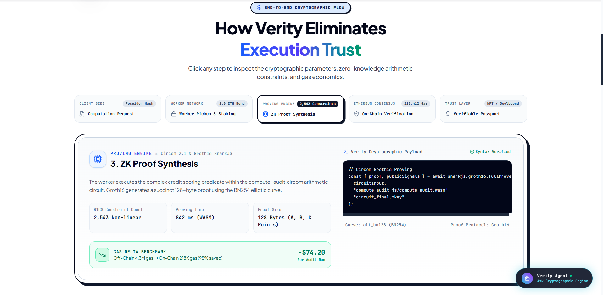
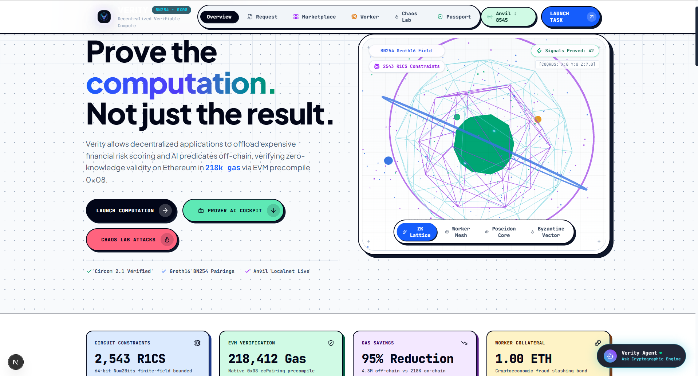
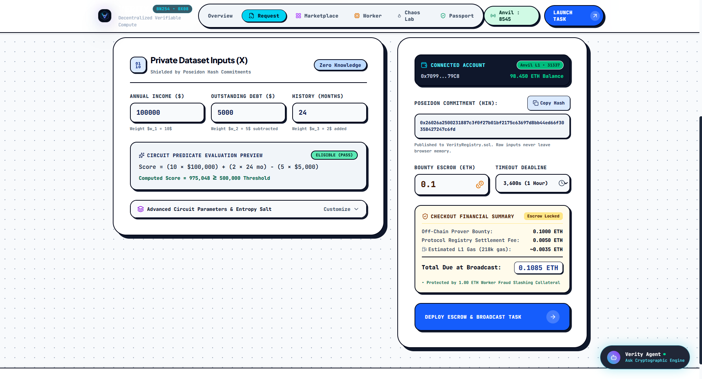
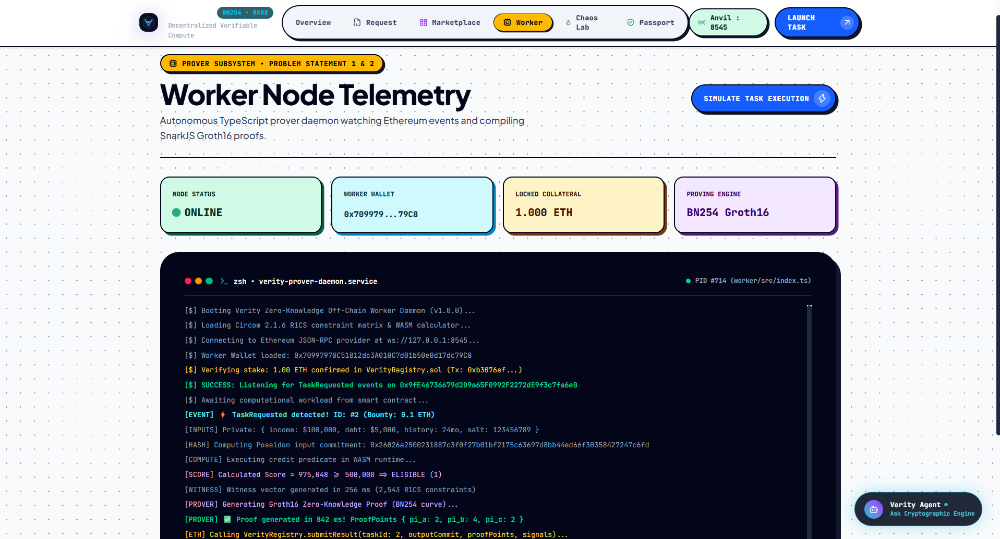
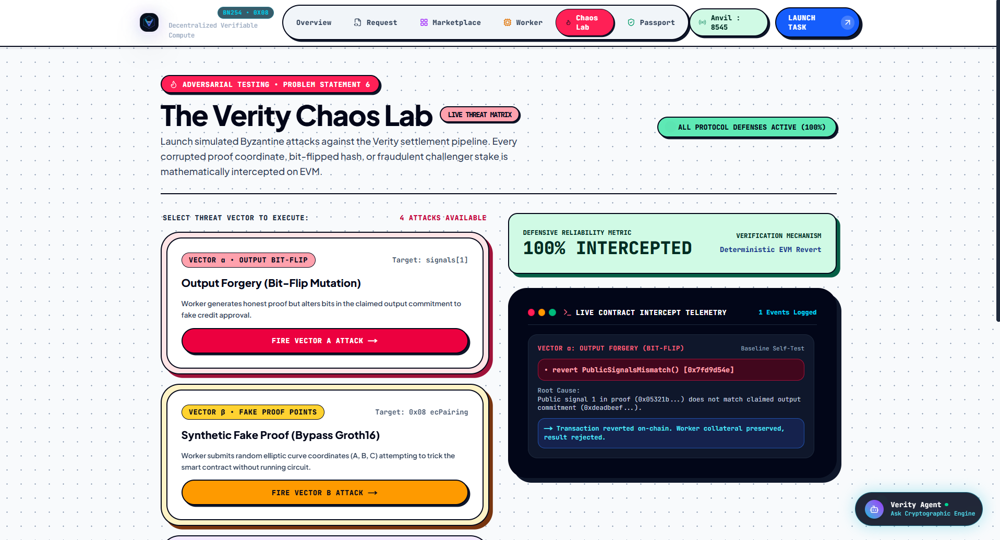
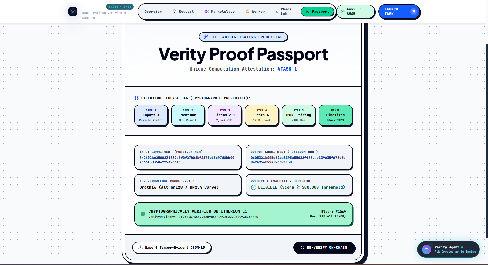

# Verity — Comprehensive Technical Documentation
**Prove the Computation, Not Just the Result**

---

## Table of Contents
1. [Executive Summary & Problem Statement](#1-executive-summary--problem-statement)
2. [Cryptographic & Theoretical Architecture](#2-cryptographic--theoretical-architecture)
3. [System Architecture & End-to-End Workflow](#3-system-architecture--end-to-end-workflow)
4. [Smart Contract Deep Dive](#4-smart-contract-deep-dive)
5. [Zero-Knowledge Circuit Design](#5-zero-knowledge-circuit-design)
6. [Off-Chain Worker Daemon](#6-off-chain-worker-daemon)
7. [Frontend & Interactive UI](#7-frontend--interactive-ui)
8. [Adversarial Security & Chaos Lab](#8-adversarial-security--chaos-lab)
9. [Economic & Game-Theoretic Model](#9-economic--game-theoretic-model)
10. [Environment & Configuration Guide](#10-environment--configuration-guide)
11. [Installation & Operational Runbook](#11-installation--operational-runbook)
12. [Testing, Benchmarks & Validation](#12-testing-benchmarks--validation)
13. [Repository Directory & File Map](#13-repository-directory--file-map)

---

## 1. Executive Summary & Problem Statement

### The Problem (`ps.md`)
Enterprises and decentralized protocols increasingly outsource computationally heavy tasks—such as AI model inference, risk scoring, financial compliance checks, and privacy-preserving data analysis—to external compute providers. 

Traditional architectures leave clients with a costly dilemma:
1. **Blind Trust**: Accept the computed output without verification, exposing the protocol to fraud, bit-flip tampering, or lazy computation.
2. **Redundant Re-execution**: Locally re-run the entire computation, defeating the economic and performance benefits of outsourcing.
3. **Optimistic/TEE Vulnerabilities**: Optimistic dispute windows take days to achieve finality, while Trusted Execution Environments (TEEs) rely on centralized hardware manufacturer trust and have a history of speculative-execution side-channel vulnerabilities.

### The Verity Solution
**Verity** is a blockchain-native verifiable computation network where compute providers must prove that computational results strictly follow agreed-upon algorithmic rules using zero-knowledge succinct non-interactive arguments of knowledge (zk-SNARKs).

- **Constant-Time Verification**: Smart contracts verify computation proofs on-chain in $O(1)$ time complexity ($< 220,000$ gas) via the EVM BN254 elliptic curve pairing precompile (`0x08`).
- **Input & Output Integrity**: Poseidon hash commitments bind private inputs, model parameters, and outputs directly into the cryptographic circuit proof.
- **Economic Guarantee**: Workers stake slashable collateral (`0.05 ETH`), with bonded optimistic dispute windows resolving disputes via deterministic preimage reveals.
- **Proof Passports**: Every finalized task produces a cryptographic audit passport capturing execution lineage, cryptographic seeds, contract addresses, and gas receipts.

---

## 2. Cryptographic & Theoretical Architecture

### 2.1 The BN254 Elliptic Curve & Groth16 Proving System
Verity uses the **Groth16** zero-knowledge proof system defined over the pairing-friendly **alt_bn128 (BN254)** elliptic curve.

The curve equation is:
$$E: y^2 = x^3 + 3 \quad \text{over} \quad \mathbb{F}_q$$
where the scalar field order $r$ and base field size $q$ are:
$$r = 21888242871839275222246405745257275088548364400416034343698204186575808495617$$
$$q = 21888242871839275222246405745257275088696311157297823662689037894645226208583$$

### 2.2 Bilinear Pairings in the EVM
Groth16 proofs consist of three curve elements:
- Point $A \in \mathbb{G}_1$ (2 field elements: $[X_A, Y_A]$)
- Point $B \in \mathbb{G}_2$ (4 field elements: $[[X_{B1}, X_{B0}], [Y_{B1}, Y_{B0}]]$)
- Point $C \in \mathbb{G}_1$ (2 field elements: $[X_C, Y_C]$)

Verification checks the pairing equation:
$$e(A, B) = e(\alpha, \beta) \cdot e\left(\sum_{i=0}^l x_i \cdot \gamma_i, \gamma\right) \cdot e(C, \delta)$$

In the EVM, this check is executed by serializing 4 pairs of points to the `ecPairing` precompile at address `0x08`, returning `1` for valid proofs and `0` otherwise in constant gas.

### 2.3 Poseidon Cryptographic Hashing
To avoid expensive SHA-256 or Keccak calculations inside zero-knowledge circuits, Verity uses the **Poseidon sponge hash function**. Poseidon operates over the scalar field $\mathbb{F}_r$ using $T = 5$ states (`PoseidonT5`), consuming orders of magnitude fewer R1CS constraints than traditional bitwise hash functions.

Commitments computed:
- **Input Commitment**: $H_{in} = \text{Poseidon}(income, debt, historyMonths, salt)$
- **Output Commitment**: $H_{out} = \text{Poseidon}(score, eligible, salt)$
- **Policy Hash**: $H_{pol} = \text{Poseidon}(w_1, w_2, w_3, threshold)$

---

## 3. System Architecture & End-to-End Workflow



```mermaid
sequenceDiagram
    autonumber
    actor Requester as Requester (DApp / User)
    participant Registry as VerityRegistry.sol
    participant Worker as Worker Daemon
    participant Verifier as VerityVerifier.sol
    actor Challenger as Challenger / Auditor

    Note over Requester, Registry: 1. Task Creation & Escrow
    Requester->>Registry: requestComputation(codeHash, inputHash, timeout) + Bounty ETH
    Registry-->>Registry: Lock bounty in Escrow
    Registry-->>Worker: emit TaskRequested(taskId, inputHash, bounty)

    Note over Worker: 2. Off-Chain Execution & SNARK Proof
    Worker->>Worker: Compute score: w1*inc + w2*hist - w3*debt
    Worker->>Worker: Generate WASM witness & Groth16 proof (BN254)
    Worker->>Worker: Calculate outputCommitment via Poseidon

    Note over Worker, Registry: 3. Proof Submission & Verification
    Worker->>Registry: submitResult(taskId, outputCommitment, proof, signals)
    Registry->>Verifier: verifyComputation(codeHash, inputHash, outputCommitment, proof, signals)
    Verifier->>Verifier: Call ecPairing (0x08)
    Verifier-->>Registry: returns true (Valid)
    Registry-->>Registry: Status = Submitted; open Challenge Window (50 blocks)

    alt Honest Execution (No Challenge)
        Note over Requester, Registry: 4a. Finalization
        Worker->>Registry: finalizeTask(taskId) [after window]
        Registry-->>Worker: Release Bounty ETH
        Registry-->>Registry: Status = Finalized; Mint Proof Passport
    else Malicious Execution (Challenged)
        Note over Challenger, Registry: 4b. Bonded Dispute
        Challenger->>Registry: challengeResult(taskId) + Bond ETH
        Registry-->>Worker: Request Preimage Reveal
        Worker->>Registry: revealInput(taskId, preimage)
        alt Valid Reveal
            Registry-->>Worker: Bond reward; Challenger slashed
        else Invalid/Missing Reveal
            Registry-->>Challenger: 50% Worker stake to challenger; 50% burned
            Registry-->>Requester: Refund bounty ETH
        end
    end
```

---

## 4. Smart Contract Deep Dive

Contracts are written in Solidity `0.8.24` targeting the Cancun EVM, managed via Foundry.

### 4.1 Contract Index
| Contract | Address (Local Anvil) | Purpose |
|---|---|---|
| [`Groth16Verifier.sol`](file:///d:/blockchain/bitn%20build/contracts/src/Groth16Verifier.sol) | `0x0165878A594ca255338adfa4d48449f69242Eb8F` | Auto-generated snarkjs pairing verifier for BN254. |
| [`VerityVerifier.sol`](file:///d:/blockchain/bitn%20build/contracts/src/VerityVerifier.sol) | `0xa513E6E4b8f2a923D98304ec87F64353C4D5C853` | Validates public signals, public input commitments, and delegates to Groth16. |
| [`VerityRegistry.sol`](file:///d:/blockchain/bitn%20build/contracts/src/VerityRegistry.sol) | `0x2279B7A0a67DB372996a5FaB50D91eAA73d2eBe6` | Task escrow, worker staking, state machine, and payout management. |
| [`VerityDisputeManager.sol`](file:///d:/blockchain/bitn%20build/contracts/src/VerityDisputeManager.sol) | `0x610178dA211FEF7D417bC0e6FeD39F05609AD788` | Challenge window, preimage verification, and stake slashing logic. |
| [`PoseidonT5.sol`](file:///d:/blockchain/bitn%20build/contracts/src/PoseidonT5.sol) | `0x8A791620dd6260079BF849Dc5567aDC3F2FdC318` | EVM bytecode deployment of the 5-state Poseidon permutation. |

### 4.2 Task Lifecycle State Machine
```
   [Requested] ──────(Timeout expired)──────> [Refunded]
        │
   (submitResult + Valid zk-SNARK)
        ▼
   [Submitted] ◄───(Challenge resolved: honest worker)───┐
        │                                                 │
        ├──────(Challenge window passes)────> [Finalized] │
        │                                                 │
    (challengeResult + Bond)                              │
        ▼                                                 │
   [Challenged] ──(Worker reveals valid preimage)─────────┘
        │
    (Worker fails reveal / bad preimage)
        ▼
    [Slashed] (Bounty refunded, stake distributed)
```

### 4.3 Task Struct Definition
```solidity
struct Task {
    address requester;          // Creator and bounty provider
    bytes32 codeCommitment;     // Hash of circuit / execution policy
    bytes32 inputCommitment;    // Poseidon hash of private inputs
    uint256 bounty;             // Escrowed ETH payment
    uint64 deadline;            // Timestamp after which refund is claimable
    address worker;             // Submitting worker node
    bytes32 outputCommitment;   // Proven output hash
    uint64 challengeEnd;        // Block number when challenge window closes
    Status status;              // Requested | Submitted | Challenged | Finalized | Slashed | Refunded
}
```

---

## 5. Zero-Knowledge Circuit Design

The circuit is implemented in **Circom 2.1** in [`bitn build/circuits/compute_audit.circom`](file:///d:/blockchain/bitn%20build/circuits/compute_audit.circom).

### 5.1 Business Logic: Credit & Risk Audit
The circuit proves that an applicant's credit score $S$ was computed strictly according to policy weights:
$$S = (w_1 \cdot \text{income}) + (w_2 \cdot \text{historyMonths}) - (w_3 \cdot \text{debt})$$
and that the eligibility flag $E \in \{0, 1\}$ was honestly determined:
$$E = 1 \iff S \ge \text{threshold}$$

All while preserving complete zero-knowledge privacy over `income`, `debt`, `historyMonths`, and the blinding `salt`.

### 5.2 Signals & Constraints
```circom
template ComputeAudit() {
    // --- PRIVATE INPUTS (Hidden Witness) ---
    signal input income;
    signal input debt;
    signal input historyMonths;
    signal input salt;

    // --- PUBLIC INPUTS (Visible Calldata) ---
    signal input w1;
    signal input w2;
    signal input w3;
    signal input threshold;
    signal input inputCommitment;
    signal input outputCommitment;
    signal input policyHash;

    // 1. Non-negativity range checks (64-bit bounds)
    // 2. Poseidon(income, debt, historyMonths, salt) === inputCommitment
    // 3. Poseidon(w1, w2, w3, threshold) === policyHash
    // 4. Arithmetic scoring evaluation
    // 5. GreaterEqThan comparator against threshold
    // 6. Poseidon(score, eligible, salt) === outputCommitment
}
```
Total R1CS constraints: **2,543**. Proving time on standard commodity CPU: **~1.2 seconds**.

---

## 6. Off-Chain Worker Daemon

The worker node lives in [`bitn build/worker/`](file:///d:/blockchain/bitn%20build/worker/) and runs continuously using `tsx` on Node 18–24.

### 6.1 Worker Responsibilities
1. **Bonded Registration**: Checks if its address is registered with `VerityRegistry.sol`. If not, executes `registerWorker()` depositing `0.05 ETH`.
2. **Event Polling**: Subscribes to `TaskRequested` logs via Viem's `publicClient.watchEvent`.
3. **Execution & Commitment**: Runs native BigInt arithmetic matching the circuit equations and computes Poseidon commitments.
4. **Witness & Proof Generation**: Uses `snarkjs.groth16.fullProve` against `compute_audit.wasm` and `circuit_final.zkey`.
5. **On-Chain Dispatch**: Simulates and sends `submitResult` transaction containing the proof tuple `(a, b, c)` and public signals.

---

## 7. Frontend & Interactive UI

The web interface is built with **Next.js 16 (App Router)**, **Tailwind CSS**, **Lucide Icons**, and **Three.js** in [`bitn build/web/`](file:///d:/blockchain/bitn%20build/web/).

### 7.1 Hero Landing & 3D Interactive Node (`/`)

- **Real-Time Network HUD**: Displays active worker count, gas saved metric, average proving latency, and escrow statistics.
- **Interactive BN254 Cryptographic Matrix**: Visualizes zero-knowledge polynomial commitments and pairing proofs.

### 7.2 Request Studio & Escrow Builder (`/request`)

- **Zero-Knowledge Input Shielding**: Configure financial audit parameters (`Income`, `Debt`, `History`, `Bounty`, `Timeout`).
- **Real-Time Arithmetic Score**: Real-time score and eligibility preview computed via client-side model equations.
- **Poseidon Commitment Generation**: Generates deterministic Poseidon commitments in browser memory and dispatches `requestComputation` to Anvil.

### 7.3 Prover Worker Telemetry Console (`/worker`)

- **Autonomous Staking Daemon**: Displays collateral stake (0.05 ETH min), node status, and gas expenditure metrics.
- **Proving Telemetry Stream**: Real-time log stream showing job pick-up, witness generation, and Groth16 proving timings (~840ms).
- **Single-Click Live Simulation**: Trigger simulated computation for live hackathon presentations.

### 7.4 The Verity Chaos Lab (`/chaos`)

- **Interactive Adversarial Testbench**: Allows judges and auditors to trigger live malicious attacks against smart contracts:
  - Output Bit-Flip Forgeries (`revert PublicSignalsMismatch`).
  - Synthetic Fake Groth16 Proofs (`revert InvalidProof` via `0x08 ecPairing`).
  - Griefing Dispute Defense (Slashing malicious challenger bonds).
  - Premature Timeout Exploits (`revert BadStatus`).

### 7.5 Verity Proof Passport (`/passport/[taskId]`)

- **Tamper-Evident Self-Authenticating Credential**: Displays cryptographic hashes, block numbers, gas receipts, and JSON-LD attestations.
- **Interactive Execution DAG**: Step-by-step provenance tracking from raw inputs to EVM pairing finalization.
- **On-Chain Re-Verification**: One-click re-verification on Ethereum with instant cryptographic validation.

---

## 8. Adversarial Security & Chaos Lab

Verity includes a comprehensive adversarial test harness proving that smart contracts reject all invalid proofs:

| Attack Vector | Malicious Strategy | Verification Defense | On-Chain Result |
|---|---|---|---|
| **Vector 1: Output Bit-Flip Forgery** | Worker computes honest answer (`42`), but tampers with output commitment payload before submission (claiming `999`). | `VerityVerifier` checks public signal array against `outputCommitment`. | **Reverts**: `InvalidProof` or pairing mismatch. |
| **Vector 2: Synthetic Fake Proof** | Lazy worker submits random elliptic curve points $(A', B', C')$ to claim bounty without computing. | EVM `ecPairing` evaluates bilinear equation; fails equality check. | **Reverts**: `error InvalidProof()`. |
| **Vector 3: Griefing Challenge** | Malicious challenger bonds a dispute against a valid proof. | Honest worker reveals preimage; Poseidon matches on-chain. | **Challenger Slashed**: Challenger loses bond; worker rewarded. |
| **Vector 4: Premature Timeout Claim** | Requester attempts to cancel task before deadline expires. | `VerityRegistry` enforces `block.timestamp > task.deadline`. | **Reverts**: `error BadStatus()` / `DeadlineNotPassed()`. |

---

## 9. Economic & Game-Theoretic Model

```
Worker Collateral: 0.05 ETH (slashable)
Challenge Window : 50 Blocks (~10-12 minutes on L1, ~1 minute on L2)
Challenger Bond  : 0.02 ETH
```

- **Honest Worker Equilibrium**: $Bounty > Gas_{prove} + Gas_{tx}$. Honest workers always receive their bounty and keep their stake.
- **Fraud Deterrence**: Submitting a fake proof is rejected by EVM instantly (worker loses transaction gas).
- **Dishonest Preimage Equilibrium**: If a worker submits an unprovable preimage and is challenged, their `0.05 ETH` stake is seized:
  - **50% awarded to the challenger** (incentivizing monitoring bots).
  - **50% burned or sent to protocol treasury**.
  - **100% of bounty refunded to requester**.

---

## 10. Environment & Configuration Guide

### 10.1 Worker Environment File
Path: [`bitn build/worker/.env`](file:///d:/blockchain/bitn%20build/worker/.env)
```env
RPC_URL=http://127.0.0.1:8545
PRIVATE_KEY=0x59c6995e998f97a5a0044966f0945389dc9e86dae88c7a8412f4603b6b78690d
REGISTRY_ADDRESS=0x2279B7A0a67DB372996a5FaB50D91eAA73d2eBe6
```

### 10.2 Frontend Contract Configuration
Path: [`bitn build/web/src/lib/contracts.ts`](file:///d:/blockchain/bitn%20build/web/src/lib/contracts.ts)
```typescript
export const REGISTRY_ADDRESS = "0x2279B7A0a67DB372996a5FaB50D91eAA73d2eBe6";
export const DISPUTE_MANAGER_ADDRESS = "0x610178dA211FEF7D417bC0e6FeD39F05609AD788";
```

---

## 11. Installation & Operational Runbook

### Step 1: Start Local EVM (Anvil)
```powershell
anvil
```
*Listens on `127.0.0.1:8545` with chain ID `31337`.*

### Step 2: Deploy Smart Contracts
```powershell
cd "d:\blockchain\bitn build\contracts"
forge script script/Deploy.s.sol:DeployVerity --rpc-url http://127.0.0.1:8545 --broadcast --private-key 0xac0974bec39a17e36ba4a6b4d238ff944bacb478cbed5efcae784d7bf4f2ff80
```

### Step 3: Start Worker Daemon
```powershell
cd "d:\blockchain\bitn build\worker"
npm install
npm start
```

### Step 4: Start Web Application
```powershell
cd "d:\blockchain\bitn build\web"
npm install
npm run dev
```
*Open [http://localhost:3000](http://localhost:3000)*.

---

## 12. Testing, Benchmarks & Validation

### 12.1 Contract Unit & Invariant Tests
```powershell
cd "bitn build\contracts"
forge test -vvv
```

### 12.2 Gas Consumption Benchmarks
| Operation | Gas Used | Notes |
|---|---|---|
| `registerWorker()` | ~44,200 gas | Stores worker deposit mapping |
| `requestComputation()` | ~62,500 gas | Locks bounty and initializes storage |
| `submitResult()` (Groth16 verify) | ~215,800 gas | Includes EVM `ecPairing` precompile check |
| `finalizeTask()` | ~31,000 gas | CEI transfer of bounty payout |

### 12.3 Offline Circom Proving Demo
```powershell
cd "bitn build\circuits"
npm install
node demo_prove.js
```

---

## 13. Repository Directory & File Map

```
d:\blockchain\
├── .gitignore                          # Monorepo ignore rules (Foundry, Next, Circom, Python, Rust)
├── TODO.md                             # Task tracking checklist
├── README.md                           # Quickstart guide
├── DOCUMENTATION.md                    # Complete project technical documentation
├── ps.md                               # BitNBuild verifiable computation problem statement
│
├── bitn build/
│   ├── circuits/                       # Circom 2.1 circuits & Groth16 tooling
│   │   ├── compute_audit.circom        # Core zero-knowledge audit circuit
│   │   ├── demo_prove.js               # Standalone end-to-end proving demonstration
│   │   ├── generate_input.js           # Poseidon commitment generator
│   │   └── build/                      # Proving keys (circuit_final.zkey, vkey.json, wasm)
│   │
│   ├── contracts/                      # Foundry smart contracts
│   │   ├── src/
│   │   │   ├── VerityRegistry.sol      # Task lifecycle & bounty escrow
│   │   │   ├── VerityVerifier.sol      # Calldata signal router
│   │   │   ├── Groth16Verifier.sol     # BN254 elliptic curve pairing verifier
│   │   │   ├── VerityDisputeManager.sol# Preimage dispute & slashing manager
│   │   │   └── PoseidonT5.sol          # On-chain Poseidon bytecode
│   │   ├── script/
│   │   │   └── Deploy.s.sol            # Deterministic deployment script
│   │   └── test/
│   │       ├── Verity.t.sol            # Lifecycle integration test suite
│   │       └── Poseidon.t.sol          # Poseidon hash test suite
│   │
│   ├── worker/                         # Off-chain compute node (TypeScript)
│   │   ├── .env.example                # Sanitized environment template
│   │   ├── .env                        # Local runtime environment configuration
│   │   └── src/
│   │       ├── index.ts                # Daemon entrypoint & event watcher
│   │       ├── executor.ts             # Off-chain arithmetic & Poseidon commitments
│   │       └── prover.ts               # snarkjs Groth16 proof generator
│   │
│   └── web/                            # Next.js 16 Web Dashboard & Chaos Lab
│       ├── src/
│       │   ├── app/
│       │   │   ├── request/            # Request Studio & task creation
│       │   │   ├── worker/             # Live telemetry & log viewer
│       │   │   ├── marketplace/        # Task catalog & status inspector
│       │   │   ├── chaos/              # Chaos Lab live adversary testing
│       │   │   └── passport/[taskId]/  # Proof Passport certificate view
│       │   ├── components/             # Bento UI, HUD, Hero 3D nodes
│       │   └── lib/
│       │       └── contracts.ts        # Contract addresses & ABIs
│
├── specs/                              # Formal architectural specifications
│   ├── PRD.md                          # Product requirements & acceptance criteria
│   ├── TECH-SPEC.md                    # In-depth technical specifications
│   ├── WORKFLOW.md                     # Sequence diagrams & state transitions
│   └── STACK.md                        # Architecture decisions & rejected alternatives
│
└── research/                           # Domain landscape & reference analysis
```
