# ⚡ VERITY — Prove the Computation, Not Just the Result

> **Decentralized Verifiable Computation Platform with $O(1)$ On-Chain Zero-Knowledge Verification**  
> Offload heavy financial scoring, risk auditing, and AI predicates off-chain with mathematical guarantees on Ethereum in **218k gas** via the native `0x08` `ecPairing` precompile.

[-363636?logo=solidity)](https://soliditylang.org/)
[-black?logo=gnuprivacyguard)](https://docs.circom.io/)
[-blue)](https://iden3.io/)
[](https://nextjs.org/)
[](https://book.getfoundry.sh/)
[](#-gas-benchmarks)
[](#-the-verity-chaos-lab-adversarial-testing)

---

## 🌟 Hero Prototype Showcase


---

## 📑 Table of Contents
- [🎯 Executive Summary & The Problem](#-executive-summary--the-problem)
- [🏆 The 7 Problem Statement Gates Solved](#-the-7-problem-statement-gates-solved)
- [🔬 How Verity Eliminates Execution Trust](#-how-verity-eliminates-execution-trust)
- [🖥️ Interactive Prototype Walkthrough](#️-interactive-prototype-walkthrough)
  - [1. Request Studio & Escrow Builder](#1-request-studio--escrow-builder-request)
  - [2. Autonomous Worker Telemetry](#2-autonomous-worker-telemetry-worker)
  - [3. The Verity Chaos Lab (Adversarial Testing)](#3-the-verity-chaos-lab-chaos)
  - [4. Verity Proof Passport](#4-verity-proof-passport-passporttaskid)
- [⚙️ Cryptographic & Mathematical Foundation](#️-cryptographic--mathematical-foundation)
- [🏛️ Smart Contract Architecture & State Machine](#️-smart-contract-architecture--state-machine)
- [⛽ Gas Benchmarks & Economic Efficiency](#-gas-benchmarks--economic-efficiency)
- [🛡️ Adversarial Security & Threat Matrix](#️-adversarial-security--threat-matrix)
- [🎮 Game Theory & Slashing Mechanics](#-game-theory--slashing-mechanics)
- [🚀 Quick Start & Local Runbook](#-quick-start--local-runbook)
- [📁 Repository Directory Map](#-repository-directory-map)
- [📘 Full Documentation Reference](#-full-documentation-reference)

---

## 🎯 Executive Summary & The Problem

Modern enterprises, decentralized lending protocols, and fintech dApps outsource compute-heavy operations—such as multi-variable credit scoring, risk evaluation, and compliance auditing—to external third-party workers. 

Today, verifying this outsourced execution forces a **fatal trade-off**:
1. **Blind Trust**: Accept the provider's claimed answer without proof, exposing protocols to silent data manipulation, bit-flip fraud, or lazy compute.
2. **Wasteful Re-execution**: Locally re-run the entire computation, discarding all performance and scalability advantages of outsourcing.
3. **Optimistic Latency (Fraud Proofs)**: Enforce multi-day challenge windows that stall execution settlement and lock protocol liquidity.
4. **Hardware TEEs**: Depend on centralized silicon manufacturers (e.g., Intel SGX) with proven vulnerability to side-channel cache attacks.

### The Verity Solution
**Verity eliminates the trade-off through verifiable zero-knowledge computation.** Requesters lock bounties into smart contract escrow; workers compute off-chain and return the result accompanied by a **Groth16 zk-SNARK proof**; Ethereum independently verifies the proof on-chain in constant $O(1)$ gas complexity (**218k gas**) using the native `0x08` `ecPairing` precompile. Valid proofs finalize instantly and release escrow; tampered proofs fail mathematical checks and revert automatically.

---

## 🏆 The 7 Problem Statement Gates Solved

Verity directly satisfies all 7 core requirements from [`ps.md`](ps.md):

| # | Problem Statement Requirement | Verity Implementation | Verification Link |
|---|---|---|---|
| **1** | **Verifiable Computation** | Real Circom 2.1 circuit compiles credit scoring into 2,543 R1CS constraints; Groth16 proves polynomial execution over BN254. | [`compute_audit.circom`](bitn%20build/circuits/compute_audit.circom) |
| **2** | **Independent Verification** | On-chain EVM bilinear pairing check at precompile address `0x08` validates proof without re-running off-chain compute. | [`VerityVerifier.sol`](bitn%20build/contracts/src/VerityVerifier.sol) |
| **3** | **Tamper-Evident Records** | Self-authenticating Proof Passports record input/output commitments, block numbers, gas receipts, and JSON-LD attestations. | [`/passport/[taskId]`](bitn%20build/web/src/app/passport/%5BtaskId%5D/page.tsx) |
| **4** | **Input & Output Integrity** | Cryptographic Poseidon hashing over the BN254 scalar field shields raw dataset values while enforcing public input equality. | [`PoseidonT5.sol`](bitn%20build/contracts/src/PoseidonT5.sol) |
| **5** | **Dispute Resolution** | Bonded 50-block challenge window with interactive preimage reveal and 50% challenger reward / 50% worker stake slash. | [`VerityDisputeManager.sol`](bitn%20build/contracts/src/VerityDisputeManager.sol) |
| **6** | **Adversarial Testing** | Interactive Chaos Lab demonstrates instantaneous contract reverts against Bit-Flips, Fake Proofs, and Griefing attacks. | [`/chaos`](bitn%20build/web/src/app/chaos/page.tsx) |
| **7** | **Execution Traceability** | Complete smart contract event lifecycle (`TaskRequested` → `TaskSubmitted` → `TaskFinalized`) logged on-chain. | [`VerityRegistry.sol`](bitn%20build/contracts/src/VerityRegistry.sol) |

---

## 🔬 How Verity Eliminates Execution Trust


Verity's pipeline consists of 5 deterministic, verifiable stages:

1. **Client Side — Computation Request**:
   The requester specifies private parameters (Income, Debt, Credit History) and model policy weights $(w_1, w_2, w_3, \text{threshold})$. The browser calculates Poseidon hash commitments ($H_{in}$) and locks the bounty in `VerityRegistry.sol`. Raw data **never leaves client memory**.
2. **Worker Network — Pickup & Staking**:
   Autonomous TypeScript workers deposit bonded collateral (`1.00 ETH` / `0.05 ETH min`) and listen for `TaskRequested` events via WebSocket/RPC.
3. **Proving Engine — ZK Proof Synthesis**:
   The worker executes the polynomial evaluation inside the WASM witness generator and compiles a 128-byte Groth16 zero-knowledge proof across 2,543 non-linear R1CS constraints in **sub-second time (842 ms)**.
4. **Ethereum Consensus — On-Chain Verification**:
   The worker calls `submitResult()`. `VerityVerifier.sol` passes curve coordinates $(A, B, C)$ and public signals to EVM precompile `0x08`. Verification takes **218,412 gas** regardless of off-chain complexity.
5. **Trust Layer — Verifiable Passport**:
   Finalized tasks generate immutable, self-authenticating Proof Passports with on-chain execution lineage, tamper-proof hashes, and verifiable replay capabilities.

---

## 🖥️ Interactive Prototype Walkthrough

### 1. Request Studio & Escrow Builder (`/request`)
*Privacy-Preserving Dataset Input & Economic Escrow Setup*


- **Zero-Knowledge Input Shielding**: Users input annual income, debt, and credit history with real-time predicate score preview:
  $$\text{Score} = (10 \times \text{Income}) + (2 \times \text{History}) - (5 \times \text{Debt}) \ge \text{Threshold}$$
- **Poseidon Commitment Generation**: Client-side hashing computes $H_{in} = \text{Poseidon}(X, \text{salt})$ in browser memory.
- **Bounty Escrow & Timeout Configuration**: Sets locked reward payout (e.g., `0.1 ETH`) and deadline timeout protection.

---

### 2. Autonomous Worker Telemetry (`/worker`)
*Real-Time Off-Chain Prover Daemon & Log Stream*


- **Automated Bonded Staking**: Automatically registers worker address on `VerityRegistry.sol` with staked collateral.
- **Event Listener Subsystem**: Subscribes to `TaskRequested` logs via Viem public client.
- **Proof Generation Stream**: Computes witness using WASM calculator, synthesizes Groth16 proof points ($A, B, C$), and dispatches `submitResult` transaction.
- **Simulate Task Execution**: Single-click trigger for live judge demonstrations.

---

### 3. The Verity Chaos Lab (`/chaos`)
*Adversarial Attack Simulation & EVM Intercept Harness*


- **Vector $\alpha$ (Output Forgery / Bit-Flip Mutation)**: Worker executes honest computation but mutates the output commitment bit before submission (`claimed: 999` vs `proven: 42`).  
  👉 **Intercepted by EVM**: `revert PublicSignalsMismatch() [0x7fd9d54e]`.
- **Vector $\beta$ (Synthetic Fake Proof / Groth16 Bypass)**: Worker submits randomized elliptic curve coordinates to bypass compute.  
  👉 **Intercepted by EVM**: `revert InvalidProof()` via `ecPairing` evaluation failure.
- **Vector $\gamma$ (Griefing Challenge Defense)**: Malicious challenger challenges honest proof. Worker reveals preimage; Poseidon matches on-chain; **challenger's bond is slashed** and paid to worker.
- **Vector $\delta$ (Premature Timeout Exploit)**: Requester attempts to withdraw escrow before deadline passes.  
  👉 **Intercepted by EVM**: `revert BadStatus()`.

---

### 4. Verity Proof Passport (`/passport/[taskId]`)
*Tamper-Evident Self-Authenticating Credential*


- **Execution Lineage DAG**: Interactive provenance visualization tracking `Inputs X` $\to$ `Poseidon` $\to$ `Circom 2.1` $\to$ `Groth16` $\to$ `0x08 Pairing` $\to$ `Finalized Block`.
- **Cryptographic Attestation**: Displays exact input commitment, output commitment, and verified predicate decision.
- **Dual Export & Re-Verify**: One-click JSON-LD credential export and live on-chain re-verification check.

---

## ⚙️ Cryptographic & Mathematical Foundation

### 1. The BN254 Pairing Check
Verity evaluates Groth16 zk-SNARKs over the pairing-friendly **BN254 (alt_bn128)** curve. Verification checks:
$$e(A, B) = e(\alpha, \beta) \cdot e\left(\sum_{i=0}^l x_i \cdot \gamma_i, \gamma\right) \cdot e(C, \delta)$$

In the EVM, points are formatted as 24 32-byte words and submitted to precompile `0x08`, returning boolean `1` upon cryptographic equality.

### 2. Poseidon Sponge Hash ($T=5$)
Standard Keccak-256 and SHA-256 require tens of thousands of R1CS constraints for bitwise operations. Verity utilizes **PoseidonT5** operating directly over the scalar field $\mathbb{F}_r$, completing hashes with **minimal constraint overhead**.
- **Input Commitment**: $H_{in} = \text{Poseidon}(income, debt, historyMonths, salt)$
- **Output Commitment**: $H_{out} = \text{Poseidon}(score, eligible, salt)$
- **Policy Hash**: $H_{pol} = \text{Poseidon}(w_1, w_2, w_3, threshold)$

### 3. Circom 2.1 Constraint Matrix
- **Total R1CS Constraints**: `2,543`
- **Private Witness Elements**: `4` (`income`, `debt`, `historyMonths`, `salt`)
- **Public Signal Inputs**: `7` (`w1`, `w2`, `w3`, `threshold`, `inputCommitment`, `outputCommitment`, `policyHash`)
- **Proving Time (WASM Engine)**: `~842 ms`

---

## 🏛️ Smart Contract Architecture & State Machine

```mermaid
stateDiagram-v2
    [*] --> Requested: requester calls requestComputation() + locks bounty
    Requested --> Submitted: worker submits valid Groth16 proof via submitResult()
    Requested --> Refunded: timeout passes without proof; requester calls claimTimeoutRefund()
    
    Submitted --> Finalized: challenge window (50 blocks) passes; finalizeTask() releases bounty
    Submitted --> Challenged: auditor deposits bond via challengeResult()
    
    Challenged --> Submitted: worker calls revealInput() with valid preimage; challenger slashed
    Challenged --> Slashed: worker fails to reveal valid preimage; worker stake slashed & bounty refunded
    
    Finalized --> [*]
    Refunded --> [*]
    Slashed --> [*]
```



### Deployed Contract Suite (Local Anvil)
| Contract | Address | Purpose |
|---|---|---|
| [`Groth16Verifier.sol`](bitn%20build/contracts/src/Groth16Verifier.sol) | `0x0165878A594ca255338adfa4d48449f69242Eb8F` | Auto-generated snarkjs pairing verifier for BN254 curve. |
| [`VerityVerifier.sol`](bitn%20build/contracts/src/VerityVerifier.sol) | `0xa513E6E4b8f2a923D98304ec87F64353C4D5C853` | Verifies public input commitments and delegates to Groth16 pairing. |
| [`VerityRegistry.sol`](bitn%20build/contracts/src/VerityRegistry.sol) | `0x2279B7A0a67DB372996a5FaB50D91eAA73d2eBe6` | Escrow custody, task state machine, and worker registration. |
| [`VerityDisputeManager.sol`](bitn%20build/contracts/src/VerityDisputeManager.sol) | `0x610178dA211FEF7D417bC0e6FeD39F05609AD788` | Handles bonded challenges, preimage reveals, and slashing economics. |
| [`PoseidonT5.sol`](bitn%20build/contracts/src/PoseidonT5.sol) | `0x8A791620dd6260079BF849Dc5567aDC3F2FdC318` | EVM bytecode implementation of 5-state Poseidon sponge hashing. |

---

## ⛽ Gas Benchmarks & Economic Efficiency

On-chain execution of non-linear financial credit predicates requires millions of gas in EVM bytecode. Verity shifts computation off-chain, verifying succinct proofs in constant time:

| Operation | Standard EVM Gas | Verity ZK-EVM Gas | Efficiency Gain |
|---|---|---|---|
| **Predicate Evaluation & Auditing** | ~4,350,000 gas | **0 gas** (off-chain) | **100% offloaded** |
| **Commitment & State Storage** | ~120,000 gas | ~62,500 gas | **48% reduction** |
| **Computation Verification** | ~4,350,000 gas | **218,412 gas** (`ecPairing`) | **95.0% gas savings** |
| **Task Finalization & Payout** | ~45,000 gas | ~31,200 gas | **30% reduction** |

---

## 🛡️ Adversarial Security & Threat Matrix

Verity is battle-tested against Byzantine attacks. The [`VerityDisputeManager.sol`](bitn%20build/contracts/src/VerityDisputeManager.sol) and [`VerityVerifier.sol`](bitn%20build/contracts/src/VerityVerifier.sol) contracts enforce mathematical defenses:

```
+---------------------------------------------------------------------------------------+
|                                    VERITY THREAT MATRIX                               |
+---------------------------------------------------------------------------------------+
| Attack Vector          | Adversary Action              | Intercept Defense   | Outcome|
+------------------------+-------------------------------+---------------------+--------+
| 1. Bit-Flip Mutation   | Mutate output hash in payload | Signals Mismatch    | Reverts|
| 2. Fake Proof Points   | Submit random G1/G2 points    | ecPairing (0x08)    | Reverts|
| 3. Griefing Challenge  | Challenge valid worker proof  | Preimage Match      | Slashed|
| 4. Premature Refund    | Cancel before deadline        | block.timestamp Ck  | Reverts|
+---------------------------------------------------------------------------------------+
```

---

## 🎮 Game Theory & Slashing Mechanics

To ensure cryptographic and economic security, Verity couples zk-SNARK verification with bonded cryptoeconomics:

- **Worker Collateral**: Workers must deposit **`0.05 ETH` minimum collateral** (`registerWorker()`).
- **Dispute Window**: Submitted proofs enter a **50-block challenge window** (~10–12 minutes on L1, ~1 minute on L2).
- **Challenger Bond**: Anyone can challenge a submitted result by depositing a **`0.02 ETH` bond**.
- **Slashing Distribution**:
  - If a challenged worker fails to provide a matching preimage for $H_{in}$, their **entire collateral is slashed**:
    - **50% awarded to the challenger** (incentivizing active network watchers).
    - **50% burned / sent to protocol treasury**.
    - **100% of bounty refunded to requester**.
  - If a challenger maliciously challenges a valid result, the worker reveals the preimage, and the **challenger's entire bond is slashed and awarded to the worker**.

---

## 🚀 Quick Start & Local Runbook

### Prerequisites
- **Node.js** `>= 18.0` (Tested on `v24.19.0`)
- **Foundry** (`forge`, `anvil`, `cast`)
- **Git**

---

### Step 1: Start Local EVM (Anvil)
In Terminal 1:
```powershell
anvil
```
*Spawns local Ethereum node on `http://127.0.0.1:8545` (Chain ID `31337`) with 10 funded accounts.*

---

### Step 2: Deploy Smart Contracts
In Terminal 2:
```powershell
cd "bitn build\contracts"
forge script script/Deploy.s.sol:DeployVerity --rpc-url http://127.0.0.1:8545 --broadcast --private-key 0xac0974bec39a17e36ba4a6b4d238ff944bacb478cbed5efcae784d7bf4f2ff80
```
*Compiles 24 Solidity contracts with Solc 0.8.24 and deploys VerityRegistry, Verifiers, and DisputeManager.*

---

### Step 3: Start the Off-Chain Worker Daemon
In Terminal 3:
```powershell
cd "bitn build\worker"
npm install
npm start
```
*Worker registers 0.05 ETH stake on-chain and actively listens for `TaskRequested` events.*

---

### Step 4: Launch Web Dashboard & Chaos Lab
In Terminal 4:
```powershell
cd "bitn build\web"
npm install
npm run dev
```
*Open **[http://localhost:3000](http://localhost:3000)** in your browser.*

---

### Step 5: Standalone ZK Prover Test (CLI)
To run offline proof generation and verification through Circom without running the blockchain:
```powershell
cd "bitn build\circuits"
npm install
node demo_prove.js
```
*Generates witness, synthesizes Groth16 proof, and verifies against `vkey.json` in ~840ms.*

---

## 📁 Repository Directory Map

```
d:\blockchain\
├── README.md                           # Master hackathon showcase & quickstart
├── DOCUMENTATION.md                    # Exhaustive 13-chapter technical reference
├── TODO.md                             # Task tracking checklist
├── ps.md                               # BitNBuild hackathon problem statement
├── docs/
│   └── screenshots/                    # High-resolution prototype showcase
│       ├── 01_hero_overview.png        # Hero landing & 3D interactive lattice
│       ├── 02_cryptographic_pipeline.png# End-to-end cryptographic flow diagram
│       ├── 03_request_studio.png       # Privacy-preserving request builder
│       ├── 04_worker_telemetry.png     # Off-chain worker node daemon
│       ├── 05_chaos_lab.png            # Live adversarial Chaos Lab
│       └── 06_proof_passport.png       # Tamper-evident Proof Passport
│
├── bitn build/
│   ├── circuits/                       # Circom 2.1 circuits & Groth16 keys
│   │   ├── compute_audit.circom        # Core R1CS audit circuit (2,543 constraints)
│   │   ├── demo_prove.js               # Standalone proof generation script
│   │   ├── generate_input.js           # Poseidon commitment calculator
│   │   └── build/                      # Proving keys (circuit_final.zkey, wasm, vkey)
│   │
│   ├── contracts/                      # Solidity 0.8.24 Foundry contracts
│   │   ├── src/
│   │   │   ├── VerityRegistry.sol      # Core state machine & bounty escrow
│   │   │   ├── VerityVerifier.sol      # Signal router & proof decoder
│   │   │   ├── Groth16Verifier.sol     # BN254 elliptic curve pairing checker
│   │   │   ├── VerityDisputeManager.sol# Preimage challenges & slashing logic
│   │   │   └── PoseidonT5.sol          # EVM Poseidon hash permutation
│   │   ├── script/
│   │   │   └── Deploy.s.sol            # Deterministic contract deployment script
│   │   └── test/                       # Foundry invariant & fuzz test suites
│   │
│   ├── worker/                         # TypeScript off-chain worker node
│   │   ├── .env.example                # Sanitized environment template
│   │   ├── .env                        # Local node configuration
│   │   └── src/
│   │       ├── index.ts                # Daemon watcher & transaction dispatcher
│   │       ├── executor.ts             # BigInt arithmetic evaluator
│   │       └── prover.ts               # snarkjs Groth16 proving wrapper
│   │
│   └── web/                            # Next.js 16 Web Dashboard & Chaos Lab
│       ├── src/
│       │   ├── app/
│       │   │   ├── request/            # Request Studio (/request)
│       │   │   ├── worker/             # Prover Telemetry Console (/worker)
│       │   │   ├── marketplace/        # Task Catalog (/marketplace)
│       │   │   ├── chaos/              # Chaos Lab Live Threat Matrix (/chaos)
│       │   │   └── passport/[taskId]/  # Proof Passport Attestation (/passport)
│       │   ├── components/             # Bento UI, HUD, Hero 3D nodes
│       │   └── lib/
│       │       └── contracts.ts        # Contract addresses & ABIs
│
└── specs/                              # Formal architectural specifications
    ├── PRD.md                          # Product requirements & user stories
    ├── TECH-SPEC.md                    # Technical specs & mathematical formulas
    ├── WORKFLOW.md                     # Sequence diagrams & knowledge graph
    └── STACK.md                        # Architecture decisions & trade-off rationale
```

---

## 📘 Full Documentation Reference

For in-depth mathematical proofs, formal state transitions, and implementation contracts:
- 📖 **[Master Technical Documentation](DOCUMENTATION.md)** — Comprehensive 13-chapter deep dive.
- 📋 **[Product Requirements Document (PRD)](specs/PRD.md)** — Vision, personas, and feature gates.
- 📐 **[Technical Specification](specs/TECH-SPEC.md)** — Circuit constraints, data layouts, and calldata decoders.
- 🔄 **[System Workflow](specs/WORKFLOW.md)** — Architectural sequence diagrams and state machine.

---

<div align="center">
  <b>Built for BitNBuild Hackathon — Solving Verifiable Computation on Ethereum</b><br>
  <i>"Don't trust the worker. Verify the math."</i>
</div>
