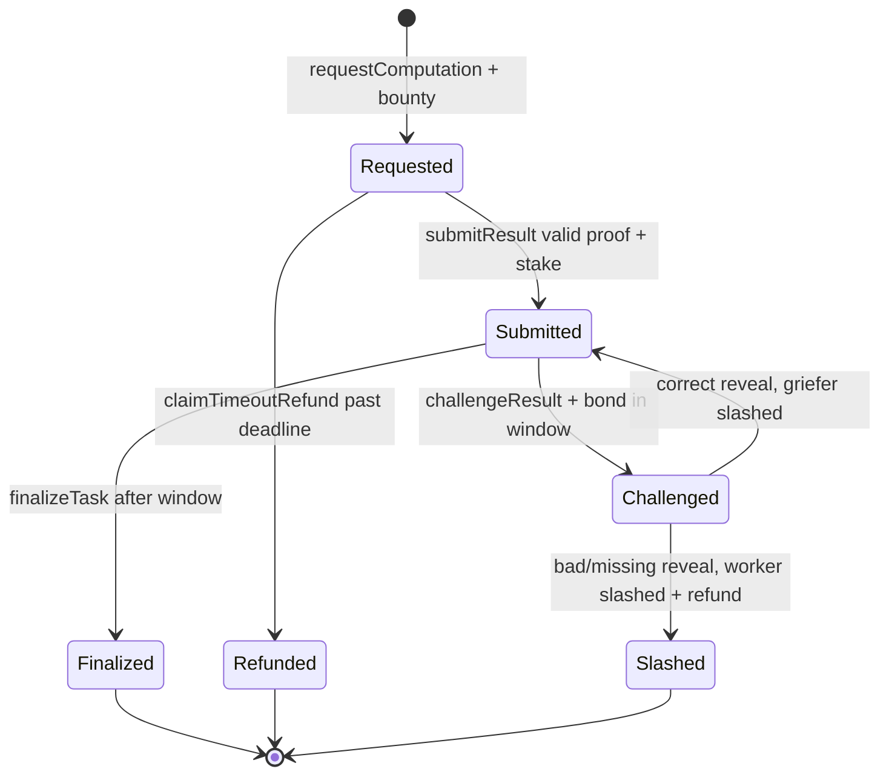
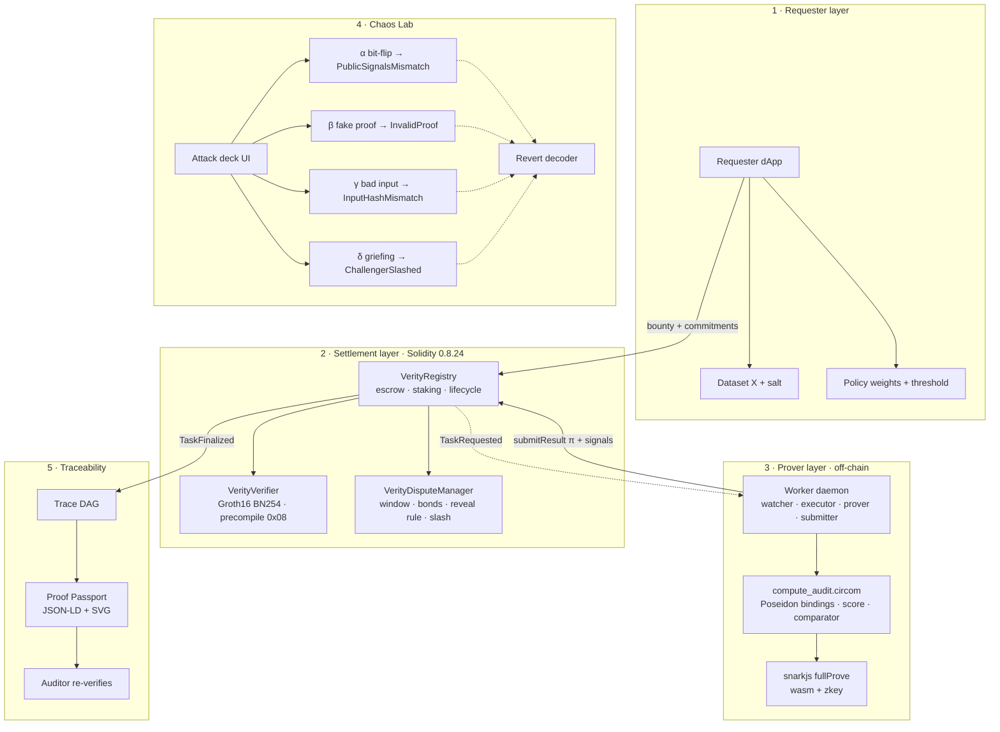

# Verity — Workflow Map

## 1. End-to-End Sequence (happy path)

```text
REQUESTER                    REGISTRY / VERIFIER / DISPUTE              WORKER                        CHALLENGER
   │  requestComputation(code,input,timeout)+bounty                            │                               │
   ├─────────────────────────────────────────►│                                │                               │
   │                                   TaskRequested                           │                               │
   │                                          ├───────────────────────────────►│                               │
   │                                          │                      execute C(X) → Y, fullProve → π           │
   │                                          │◄── submitResult(Y,π)+stake ────┤                               │
   │                                          │  verifyProof(π, signals) via 0x08                              │
   │                                          │  Submitted · challenge window (50 blocks)                      │
   │                                          ├──────────────────────────────────────────────────────────────►│
   │                                          │◄── (no challenge) ─────────────────────────────────────────────┤
   │  ◄── TaskFinalized · bounty → worker ────┤                                │                               │
   │  Proof Passport exported                 │                                │                               │
```

Disputed path: `challengeResult`+bond → worker `revealInput(preimage)` → correct reveal clips the
griefer's bond; missing/wrong reveal slashes the worker (50% challenger / 50% treasury-or-burn)
and refunds the requester 100%.

## 2. Task State Machine



## 3. Architecture Knowledge Graph (graphify output)



Entity registry: `VerityRegistry` (orchestrates funds/state), `VerityVerifier` (pairing check),
`VerityDisputeManager` (bonds/slash), `compute_audit.circom` (R1CS rules), `worker/*`
(event→prove→submit), `chaos/*` (4 attack vectors + decoder), `trace/*` + `passport/*`
(lineage + credential). Full interface table: `TECH-SPEC.md §2–§6`.

## 4. Chaos-Lab Attack Flows (each must end in the specified revert/slash)

| Vector | Attacker action | Contract reaction | UI shows |
|---|---|---|---|
| α bit-flip | Honest π, `outputCommitment` altered | `PublicSignalsMismatch()` | claimed vs proven output diff |
| β fake proof | Random (a,b,c) points | `InvalidProof()` | pairing equation failure |
| γ bad input | Proof over `X_fake`, task commits `X_real` | `InputHashMismatch()` | commitment comparison |
| δ griefing | Bonded challenge of a *valid* proof | Worker reveals preimage → `ChallengerSlashed` | bond burn animation |

## 5. Real-World Process Contrast

Blind-trust today: raw data over HTTP → black-box container (skipped iterations, stale models,
MITM edits) → bare JSON `{score}` → accept-or-rerun dilemma. Verity replaces every arrow with a
commitment, a proof, or an escrowed bond — the diagram in §1 is the enforceable replacement.
